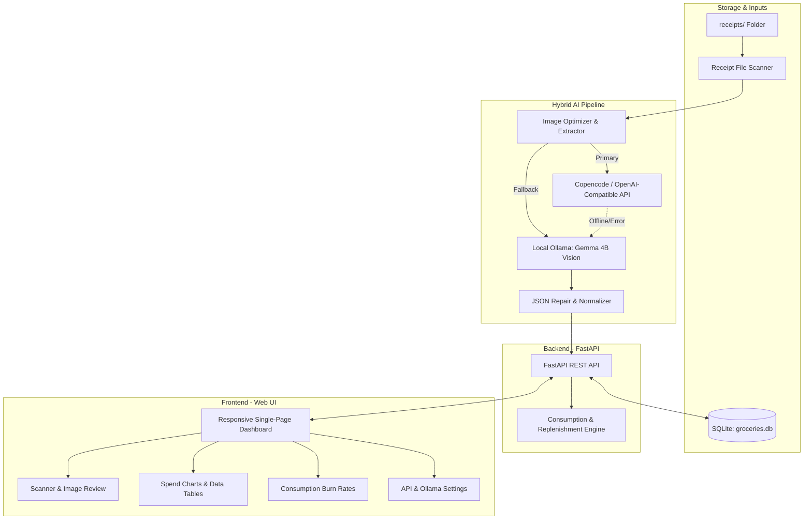

# 🛒 PantryPulse

> **Local Grocery Receipt Scanner, Spending Analytics & Smart Replenishment Forecasting**

PantryPulse is a lightweight, local-first web application that converts physical grocery receipts from your `receipts/` folder into structured records. It features a **hybrid vision AI pipeline** (Copencode / OpenAI-compatible API with automatic local Ollama Gemma fallback), interactive side-by-side verification, spend reporting by provider/category/item, and a **replenishment estimator** that projects your daily, weekly, and monthly burn rates.

---

## ✨ Key Features

- **📷 Hybrid Vision Receipt Extraction**:
  - **Primary API**: Works with Copencode, OpenRouter, OpenAI, or any OpenAI-compatible multimodal endpoint.
  - **Local Ollama Fallback**: Automatically falls back to offline local inference via Ollama (`gemma4:e2b` or any vision model) if the primary API is offline or unconfigured.
  - **Smart Image Optimizer**: Auto-corrects smartphone EXIF rotation and scales photos for fast processing.
- **🔍 Side-by-Side Review & Verification Modal**:
  - Zoom, pan, and inspect receipt photos directly alongside detected store names, purchase dates, and editable item tables.
  - Modify quantities, units, unit prices, totals, or categories with automatic total recalculation before saving.
- **📊 Comprehensive Spending Analytics**:
  - Filter by supermarket provider, category, and date range.
  - Visual charts powered by Chart.js (Spend by Supermarket and Category Breakdown).
  - Searchable items breakdown table with purchase frequencies and average unit costs.
  - **One-click CSV & JSON export**.
- **⚡ Consumption & Replenishment Intelligence**:
  - Computes exact consumption burn rates across multi-trip purchase intervals:
    - **Daily Burn Rate** ($\text{units/day}$)
    - **Weekly Burn Rate** ($\times 7$)
    - **Monthly Burn Rate** ($\times 30.4$)
  - Predicts **Days Remaining** until inventory depletion based on last purchase date and batch size.
  - Highlights restocking priority: `Restock Needed` (Overdue), `Running Low` (≤ 3 days left), and `Sufficient`.
- **⚙️ Live Engine Connectivity Tests**:
  - Integrated testing buttons in the Settings tab to verify credentials, ping latency, and model availability for both Primary API and local Ollama.

---

## 🏗️ Architecture Overview



---

## 🚀 Quick Start

### Prerequisites
- **Python 3.10+** (Python 3.11 recommended)
- *(Optional)* [Ollama](https://ollama.com/) with a vision model (e.g. `ollama pull gemma4:e2b`) for 100% offline local extraction.

### Option 1: One-Click Launch (Windows)
Double-click `start.bat`:
```cmd
start.bat
```
*This boots the FastAPI server on `http://127.0.0.1:8000` and automatically opens your default browser.*

### Option 2: Manual Setup

1. **Clone or enter the directory**:
   ```bash
   cd groceries-replenishment
   ```

2. **Create and activate a virtual environment**:
   ```powershell
   # Windows PowerShell
   python -m venv .venv
   .\.venv\Scripts\Activate.ps1
   ```
   ```bash
   # Linux / macOS
   python3 -m venv .venv
   source .venv/bin/activate
   ```

3. **Install dependencies**:
   ```bash
   pip install -r requirements.txt
   ```

4. **Launch the application**:
   ```bash
   python run.py
   ```
   Visit **`http://127.0.0.1:8000`** in your browser.

---

## ⚙️ Configuration

Copy `.env.example` to `.env` or configure directly within the **Settings** tab in the web dashboard:

```env
# Primary Vision API (Google AI Studio / OpenAI / OpenRouter / Copencode)
# If left empty, the application automatically uses local Ollama fallback
PRIMARY_API_BASE_URL=https://generativelanguage.googleapis.com/v1beta/openai
PRIMARY_API_KEY=AIzaSy...
PRIMARY_VISION_MODEL=gemini-2.0-flash

# Local Ollama Fallback
OLLAMA_BASE_URL=http://127.0.0.1:11434
OLLAMA_MODEL=gemma4:e2b
OLLAMA_TIMEOUT_SECONDS=180

# Application Host & Port
HOST=127.0.0.1
PORT=8000
RECEIPTS_DIR=receipts
DB_PATH=groceries.db
```

> **Tip:** Google AI Studio (Gemini) keys work out of the box using Google's official OpenAI-compatible endpoint: `https://generativelanguage.googleapis.com/v1beta/openai`. You can verify your connection anytime in the dashboard under **Settings** by clicking **`⚡ Test Primary API`** or **`🦙 Test Ollama`**.

---

## 📖 How to Use

1. **Add Receipts**:
   - Place smartphone photos of grocery receipts (`.jpg`, `.jpeg`, `.png`, `.webp`) into the `receipts/` directory.
2. **Scan & Parse**:
   - Navigate to the **Receipt Scanner** tab and click **Scan /receipts**.
   - Click **`⚡ Parse Receipt`** on any unprocessed file.
3. **Review & Confirm**:
   - Inspect the image in the zoomable viewer on the left.
   - Check or edit the detected store name, date, quantities, and categories on the right.
   - Click **`💾 Confirm & Save Record`**.
4. **Analyze Spending**:
   - Go to **Reports & Spend** to view provider distribution, category share, and export records as CSV or JSON.
5. **Track Replenishment**:
   - Go to **Consumption Estimator** to see daily/weekly/monthly usage, remaining stock, and items flagged for restocking.

---

## 📡 REST API Reference

| Method | Endpoint | Description |
|---|---|---|
| `GET` | `/api/receipts/files` | Lists files in `receipts/` with processing status |
| `POST` | `/api/receipts/parse/{filename}` | Runs hybrid extraction on a specific image |
| `POST` | `/api/receipts/save` | Persists confirmed receipt and line items into SQLite |
| `GET` | `/api/receipts` | Lists all saved receipts with item counts |
| `GET` | `/api/receipts/{id}` | Fetches full receipt details and line items |
| `DELETE` | `/api/receipts/{id}` | Deletes a receipt and cascades to its line items |
| `GET` | `/api/reports` | Aggregates spend by provider, category, item, and date |
| `GET` | `/api/reports/export` | Downloads report as CSV (`?format=csv`) or JSON (`?format=json`) |
| `GET` | `/api/consumption` | Computes daily, weekly, and monthly replenishment metrics |
| `GET` | `/api/categories` | Returns standard taxonomy and custom categories |
| `GET` | `/api/providers` | Lists distinct supermarket providers in database |
| `GET` | `/api/settings` | Retrieves current AI and system settings |
| `POST` | `/api/settings` | Updates AI and system settings |
| `POST` | `/api/settings/test-primary` | Live test of Primary API credentials and latency |
| `POST` | `/api/settings/test-ollama` | Live test of Ollama server and installed models |
| `GET` | `/api/receipt-image/{filename}` | Securely serves receipt image for preview |

---

## 🧪 Running Automated Tests

Run the pytest suite to verify database CRUD, extraction repair, consumption mathematics, and API endpoints:

```powershell
.\.venv\Scripts\python.exe -m pytest tests/
```

---

## 📂 Repository Structure

```
groceries-replenishment/
├── .env.example             # Configuration settings template
├── .gitignore               # Ignored files (venv, db, cache, keys)
├── requirements.txt         # Python package dependencies
├── run.py                   # App entrypoint and auto-browser launcher
├── start.bat                # Windows 1-click startup script
├── README.md                # Project documentation
├── backend/
│   ├── __init__.py          # Package initialization
│   ├── db.py                # SQLite schema, queries, and migrations
│   ├── extractor.py         # Image optimizer & hybrid vision pipeline
│   ├── analytics.py         # Consumption forecasting and reporting engine
│   └── main.py              # FastAPI application & route definitions
├── frontend/
│   ├── index.html           # Single-page application layout
│   ├── styles.css           # Modern dark-mode styling and animations
│   └── app.js               # Client state, Chart.js, and modal logic
├── tests/
│   └── test_app.py          # Pytest automated test suite
├── receipts/                # Local receipt photos folder
└── docs/
    └── ARCHITECTURE.md      # Deep dive into mathematics and data models
```

---

## 📄 License
MIT License. Free to use and customize locally.
