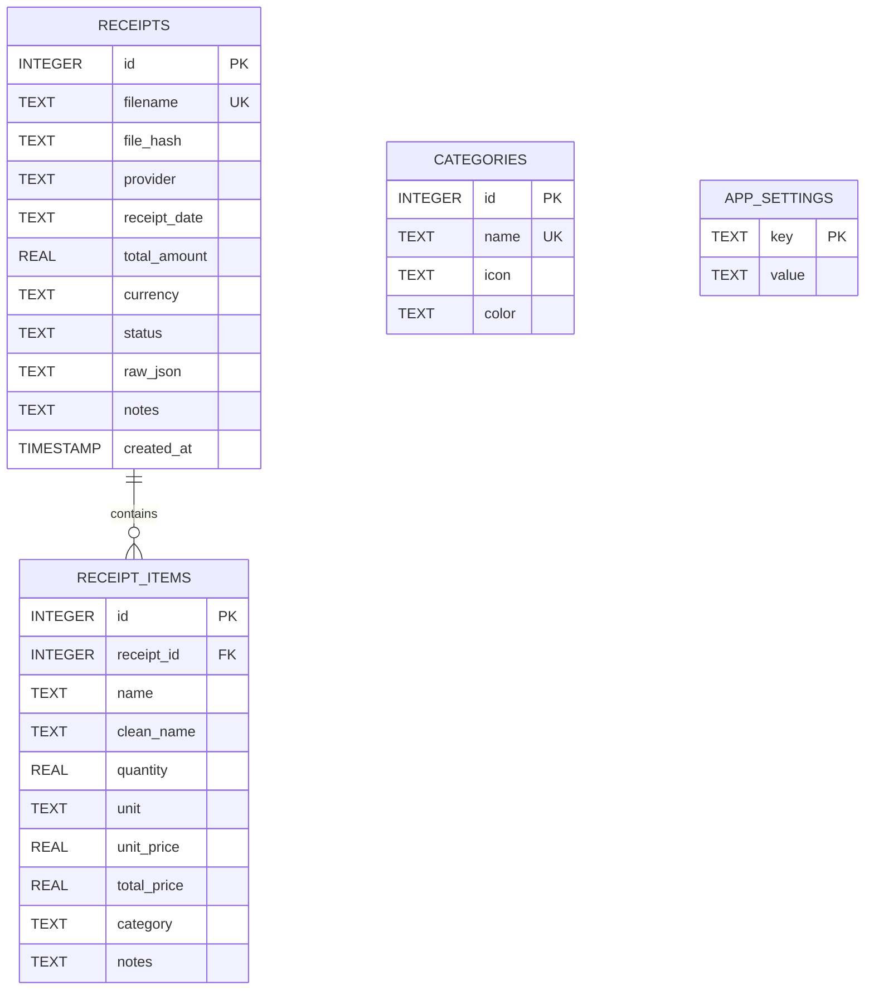

# 📐 PantryPulse Architecture & Technical Specifications

This document outlines the core technical architecture, data model, and mathematical formulas utilized by PantryPulse for receipt extraction, spend aggregation, and replenishment estimation.

---

## 1. Database Schema & Data Models

PantryPulse utilizes a local SQLite database (`groceries.db`) with foreign key enforcement enabled (`PRAGMA foreign_keys = ON`).



### Table Breakdown
- **`receipts`**: Stores metadata for each physical receipt (filename, supermarket/provider name, purchase date, total amount, currency, and complete raw model extraction JSON).
- **`receipt_items`**: Individual line items associated with a receipt. Stores both raw `name` (as printed) and normalized `clean_name` (e.g., `Whole Milk 1L`) to enable cross-trip item aggregation. Cascades deletion when a parent receipt is removed.
- **`categories`**: Taxonomy list with emoji icons and hex color codes used for visual reporting.
- **`app_settings`**: Key-value store for application preferences and credentials (`PRIMARY_API_BASE_URL`, `PRIMARY_API_KEY`, `OLLAMA_MODEL`, etc.).

---

## 2. Hybrid Extraction Pipeline

The receipt parsing engine employs a two-tier hybrid fallback strategy:

```mermaid
sequenceDiagram
    participant User
    participant App as Backend (FastAPI)
    participant Opt as Image Optimizer
    participant Prim as Primary API (Copencode / OpenAI-compatible)
    participant Oll as Local Ollama (Gemma 4B)
    participant DB as SQLite DB

    User->>App: Parse /receipts/image.jpg
    App->>Opt: Load, EXIF transpose, downscale to max 1400px
    Opt-->>App: Base64 JPEG string
    
    alt Primary API Configured
        App->>Prim: Chat Completion (System Prompt + Image URL)
        alt Success
            Prim-->>App: Structured JSON
        else Failure / Offline
            App->>Oll: Fallback /api/generate (Image Base64)
            Oll-->>App: Structured JSON
        end
    else No Primary API Configured
        App->>Oll: Fallback /api/generate (Image Base64)
        Oll-->>App: Structured JSON
    end

    App->>App: Clean JSON (strip markdown fences, regex fix trailing commas)
    App-->>User: Parsed receipt data + Engine metadata
    User->>App: Verify & Save Record
    App->>DB: Persist receipt + items
```

### Preprocessing & Normalization
1. **EXIF Orientation Correction**: Phone photos frequently store orientation in EXIF tags. `ImageOps.exif_transpose` ensures receipts are processed right-side up.
2. **Dimension Constraints**: Large images (> 1400px) are scaled down using Lanczos resampling to preserve text legibility while keeping payload sizes below 300KB.
3. **Resilient JSON Parser**: `clean_json_response` isolates JSON blocks embedded within markdown code fences (` ```json `), strips explanatory commentary, and cleans trailing commas.

---

## 3. Replenishment & Consumption Mathematics

PantryPulse models grocery consumption dynamically using purchase timestamps and quantities.

### Multi-Purchase Items ($n \ge 2$)
For items purchased across multiple shopping trips at dates $D_1, D_2, \dots, D_n$ with quantities $Q_1, Q_2, \dots, Q_n$:

1. **Elapsed Time Span**:
   $$\Delta t = D_n - D_1 \quad (\text{days})$$

2. **Daily Consumption Burn Rate ($R_{\text{day}}$)**:
   Between the initial purchase $D_1$ and the latest purchase $D_n$, the household consumed the batches prior to the latest restock:
   $$R_{\text{day}} = \frac{\sum_{i=1}^{n-1} Q_i}{\Delta t}$$

   *(If all purchases occurred on the same date, $\Delta t = 0$, the algorithm falls back to single-purchase estimation).*

3. **Weekly & Monthly Projections**:
   $$R_{\text{week}} = R_{\text{day}} \times 7$$
   $$R_{\text{month}} = R_{\text{day}} \times 30.4$$

4. **Inventory Depletion Projection**:
   Given current reference date $D_{\text{now}}$ and days elapsed since latest purchase:
   $$t_{\text{elapsed}} = D_{\text{now}} - D_n$$
   Estimated stock remaining:
   $$Q_{\text{rem}} = \max\left(0, \, Q_n - (t_{\text{elapsed}} \times R_{\text{day}})\right)$$
   Estimated days until depletion:
   $$\text{Days Left} = \begin{cases} \frac{Q_{\text{rem}}}{R_{\text{day}}} & \text{if } R_{\text{day}} > 0 \\ \infty & \text{otherwise} \end{cases}$$

5. **Restock Priority Status**:
   - **`Restock Needed`** (`overdue`): $\text{Days Left} \le 0$
   - **`Running Low`** (`low`): $0 < \text{Days Left} \le 3$
   - **`Sufficient`** (`ok`): $\text{Days Left} > 3$

### Single-Purchase Baseline ($n = 1$)
For items seen only once:
- If days elapsed $t_{\text{elapsed}} > 0$:
  $$R_{\text{day}} = \frac{Q_1}{\max(t_{\text{elapsed}}, \, 7)}$$
- If purchased today ($t_{\text{elapsed}} = 0$):
  Uses category baselines (7 days for fresh produce/dairy/bakery; 14 days for pantry goods).

---

## 4. Frontend Design Architecture

- **Zero-Build Vanilla Stack**: Pure HTML5, modern CSS3 with custom variables, and vanilla ES6+ JavaScript. No build step or node_modules runtime required.
- **Visual Design System**:
  - Color Tokens: Deep slate `#0B0F19`, `#111827`, `#182234` paired with vivid Indigo `#6366F1`, Emerald `#10B981`, Amber `#F59E0B`, and Rose `#EF4444`.
  - Typography: Google Font **Inter** for clean readability of numerical data.
  - Micro-animations and transitions (`all 0.2s cubic-bezier(0.4, 0, 0.2, 1)`).
- **Visualization**: Chart.js 4.4 loaded via CDN for responsive, performant HTML5 Canvas charts.
